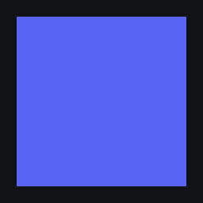

<p align="center"></p>

# Arachnid Client

Настольный клиент [Stoat](https://stoat.chat/) (бывший Revolt) на Tauri 2 и Rust.

Интерфейс — **официальный веб-клиент Stoat** ([for-web](https://github.com/stoatchat/for-web))
без изменений: внешний вид и все функции те же, что на stoat.chat, и новые
функции появляются сразу, как только их выкатывают на сервер. Так же устроен
официальный [Stoat for Desktop](https://github.com/stoatchat/for-desktop) на Electron:
он открывает `https://stoat.chat/app` и добавляет нативный слой. Arachnid Client
делает то же самое, только нативный слой написан на Rust, а окно — системный
webview (WebView2 в Windows) вместо встроенного Chromium.

## Что делает оболочка

| Возможность | Как |
|---|---|
| Своя рамка окна | рамка for-web (`customFrame`), кнопки «Свернуть / Развернуть / Закрыть» — команды Rust; перетаскивание по `-webkit-app-region` |
| Трей | значок с меню «Версия», «Расширения», «Показать / Скрыть», «Выйти»; закрытие окна прячет его в трей («Сворачивать в трей») |
| Темы и QuickCSS | `themes/*.css` или папки с `theme.toml` (свои картинки и шрифты): тема выбирается в «Внешнем виде» (или в трее) и применяется сразу, там же «Папка тем» и «Изменить QuickCSS» — редактор CSS прямо в окне клиента; свои настройки темы (палитры, цвета, размеры в формате UserCSS) показываются вместо встроенных цветов Stoat; `quickcss.css` действует всегда ([docs/extensions.md](docs/extensions.md)) |
| Плагины | ядро клиента и встроенные плагины (окно эмодзи с разделами и крупные эмодзи в реакциях — «Quality of Life», выключается) плюс свои: `plugins/*.js` в формате Avia Client или папки с `plugin.toml` — API `plugin` с настройками, хранилищем, своими файлами, сетью по разрешению и нативным модулем WebAssembly в песочнице; раздел настроек «Плагины» (между «Внешним видом» и «Уведомлениями») с переключателями и действиями плагинов (`window.AviaMenu`), то же в трее ([docs/extensions.md](docs/extensions.md)) |
| Экономия памяти | пока окно свёрнуто или в трее, WebView2 переводится в экономный режим (`MemoryUsageTargetLevel`), клиент продолжает работать ([docs/desktop.md](docs/desktop.md#память)) |
| Автозапуск | «Запускать вместе с компьютером» и «Запускать свёрнутым в трей» |
| Выбор эмодзи | стандартные эмодзи разбиты на разделы с заголовками с тем же составом, что в Discord («Люди», «Природа», «Еда и напитки», «Занятия», …, «Флаги»), разделы в колонке слева, быстрый переход к стандартным эмодзи и «Часто используемые»; набор эмодзи по умолчанию — Twemoji, он встроен в клиент и показывается сразу, без загрузки с static.stoat.chat |
| Наборы эмодзи | Fluent 3D, Fluent Color, Fluent Flat, Mutant Remix и Noto скачиваются и удаляются прямо в шторке выбора набора («Внешний вид» → «Emoji Pack»: размер, кольцо загрузки с процентами, отмена, удаление) и затем тоже показываются без загрузки с сервера; Fluent Color и Fluent Flat в Windows 11 уже есть в системном шрифте Segoe UI Emoji — тогда они помечены «В системе» и не скачиваются (Fluent 3D в Windows нет, он скачивается) |
| Discord RPC | статус «Chatting with others», как у Stoat for Desktop; выключен, пока его не включат в разделе «ПК» |
| Проверка орфографии | вкл./выкл. из раздела «ПК»; подсказки и «Добавить в словарь» — в контекстном меню WebView2 |
| Аппаратное ускорение | вкл./выкл. (после перезапуска) |
| Положение окна | размер, место и развёрнутость запоминаются |
| Ссылки | внешние ссылки открываются в системном браузере, окно не уходит с клиента |
| Уведомления, звонки, демонстрация экрана | веб-API WebView2: системные уведомления Windows, выбор экрана; микрофон, камера и звук — без запросов, только для клиента |
| Масштаб и перезагрузка | Ctrl + колесо / Ctrl + `+` `-` `0`, F5 / Ctrl + R |
| Portable-режим | `config.toml` рядом с exe: вход, сессия и настройки хранятся в той же папке |

Раздел настроек «ПК» и версия оболочки в настройках — родные страницы for-web:
он показывает их, когда находит договор `window.native` / `window.desktopConfig`.
Оболочка добавляет к ним раздел «Плагины» в «Настройках клиента», выбор
темы в «Внешнем виде» и подпись «Arachnid Client» внизу списка настроек.
Подробнее — [docs/desktop.md](docs/desktop.md).

## Структура

```
apps/desktop/src-tauri/   оболочка: окно, мост к веб-клиенту, трей, Discord RPC
  src/bridge.js           window.native и window.desktopConfig для for-web
  src/settings.js         раздел «Плагины», выбор темы и подпись в настройках
  src/defaults.js         значения по умолчанию для настроек for-web (Twemoji)
  src/emoji.js            разделы с заголовками и «Часто используемые» в выборе эмодзи
  src/emoji_mapping.json  список стандартных эмодзи for-web (emojiMapping.json)
  src/emoji_categories.json  эмодзи for-web по разделам Discord (собирает tools/emoji_categories.mjs)
  src/emoji_packs.js      скачивание и удаление наборов эмодзи в шторке выбора набора
  src/desktop.rs          окно, настройки «ПК», трей, автозапуск, команды моста
  src/extensions.rs       темы, QuickCSS, плагины, меню плагинов в трее
  src/usercss.rs          настройки тем в формате UserCSS
  src/memory.rs           экономия памяти WebView2 в фоне
  src/icon.rs             чёткие значки окна и трея (Windows)
  src/media.rs            микрофон, камера и звук без запросов (Windows)
  src/emoji_packs.rs      наборы эмодзи вместо static.stoat.chat: встроенный и скачанные (Windows)
  src/system_emoji.rs     Fluent Color и Flat из шрифта Segoe UI Emoji без скачивания (Windows 11)
  src/http.rs             скачивание по HTTPS через WinHTTP (Windows)
  emoji/                  twemoji.bin, сборка наборов (fetch.mjs, pack.mjs) и лицензия графики
  tools/                  разделы эмодзи как у Discord (emoji_categories.mjs, discord_categories.json)
  e2e/                    проверка собранного exe в настоящем WebView2 (CI: windows.yml)
  src/instance.rs         адрес веб-клиента из config.toml
bootstrap/                скачиваемые установщики: bootstrap.sh, bootstrap.ps1
docs/                     документация
```

## Установка в отдельную папку (без официального Stoat)

Скачайте один файл и запустите — дальше он сам развернёт всё нужное:

```powershell
# Windows
powershell -ExecutionPolicy Bypass -File .\bootstrap.ps1
```

```bash
# Linux / macOS
chmod +x bootstrap.sh && ./bootstrap.sh
```

По умолчанию ставит в `~/Arachnid-Client`: `config.toml`, `logs/`, `themes/`,
`plugins/`, `vendor/` (ответ инстанса и сама сборка клиента). Официальный Stoat при этом не
задействован, перенос папки ничего не ломает. Подробности —
[docs/install.md](docs/install.md).

Варианты: `--dir <папка>`, `--check` (только проверки), `--github-token <PAT>`
(для приватного репозитория).

## Свой инстанс

В `config.toml` укажите адрес веб-клиента своего сервера:

```toml
[instance]
app_url = "https://stoat.example.com"
```

Нативные команды доступны только страницам с этого адреса.

## Быстрый старт для разработки

```bash
cargo test -p arachnid-client
cargo build --release -p arachnid-client           # клиент (см. docs/build.md)
```

## Принципы

- **Интерфейс не переписывается.** Окно показывает официальный for-web как есть;
  оболочка сама не правит его DOM и не подменяет скрипты. Темы и плагины
  применяются, только если вы их включили.
- **Тот же договор, что у Stoat for Desktop.** `window.native` и
  `window.desktopConfig` повторяют preload официального клиента, поэтому for-web
  сам включает свою рамку окна и раздел «ПК».
- **Минимум прав.** Команды моста разрешены только адресу веб-клиента и только в
  главном окне; переходы на другие сайты блокируются.

## Документация

- [docs/desktop.md](docs/desktop.md) — как устроена оболочка: мост, права, окно
- [docs/install.md](docs/install.md) — установка бутстрапом, структура папки, portable-режим
- [docs/build.md](docs/build.md) — сборка из исходников и релизы
- [docs/extensions.md](docs/extensions.md) — темы, QuickCSS и плагины: где лежат, как
  включать, как устроено, безопасность
- [docs/avia-setup-windows.md](docs/avia-setup-windows.md) — избранные гифки,
  переводчик и другие плагины Avia Client в Arachnid Client

## Лицензия

AGPL-3.0-or-later. Веб-клиент Stoat (for-web) распространяется под AGPL-3.0 и
загружается с сервера инстанса; в сборку он не входит.
